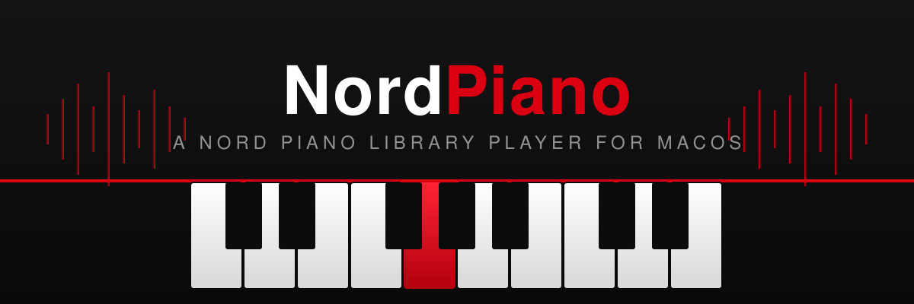

<p align="center">
  
</p>

<p align="center">
  A native macOS player for Nord Piano (<code>.npno</code>) and Nord Sample (<code>.nsmp3</code>/<code>.nsmp4</code>) libraries.<br>
  Plug in a MIDI keyboard and play your Nord sounds without the Nord.
</p>

---

## Features

- **SwiftUI app** — load piano and sample libraries into layered mixer channels, each with its own FX chain: 3-band EQ, low-pass filter, compressor, drive, delay, and reverb
- **CLI** — inspect library files (`info`), play a scale to verify decoding (`demo`), or play live over MIDI (`play`)
- **Real-time engine** — low-latency CoreMIDI input and CoreAudio/AVAudioEngine output, polyphonic voices with loops, release envelope, and sustain pedal support
- **Native decoders** — Swift ports of the NSP/CNSP (piano) and NW1 (sample) codecs, decoded locally on your machine

## Requirements

- macOS 13+
- Swift 6.2+ (Xcode 26 or a recent Swift toolchain)
- A MIDI keyboard for live playing (optional for the `demo` command)

## Build & run

```sh
swift build
```

CLI:

```sh
.build/debug/nordpiano info /path/to/piano.npno    # print zones, strokes, loops
.build/debug/nordpiano demo /path/to/piano.npno    # play a middle-C scale
.build/debug/nordpiano play /path/to/piano.npno    # live MIDI in → audio out (Ctrl-C to quit)
```

App:

```sh
swift run NordPianoApp
```

Or use `build-app.sh` to build a release binary, deploy it into `~/Applications/NordPiano.app`, re-sign, and flush the Launch Services/Dock caches:

```sh
./build-app.sh
```

## Project layout

| Path | What it is |
|---|---|
| `Sources/NordPianoCore` | `.npno`/CNSP and `.nsmp3`/`.nsmp4` decoders |
| `Sources/NordPianoEngine` | Real-time player: voices, mixer channels, FX chains |
| `Sources/nordpiano` | Command-line tool (`info`, `demo`, `play`) |
| `Sources/NordPianoApp` | SwiftUI app (keyboard, mixer, channel FX panels) |
| `Tests/NordPianoCoreTests` | Decoder tests with oracle fixtures |

## Tests

```sh
swift test
```

## Acknowledgements & legal

The decoders are Swift ports of [OpenNord](https://github.com/simonflore/opennord)'s `nsp`/`nsp-audio` and `nsmp` codec code (AGPL-3.0). This project is not affiliated with or endorsed by Clavia / Nord.

Decode is local-only: Nord factory libraries are Clavia's copyrighted audio. Use libraries you own, and never extract, convert, or share their sample content.
